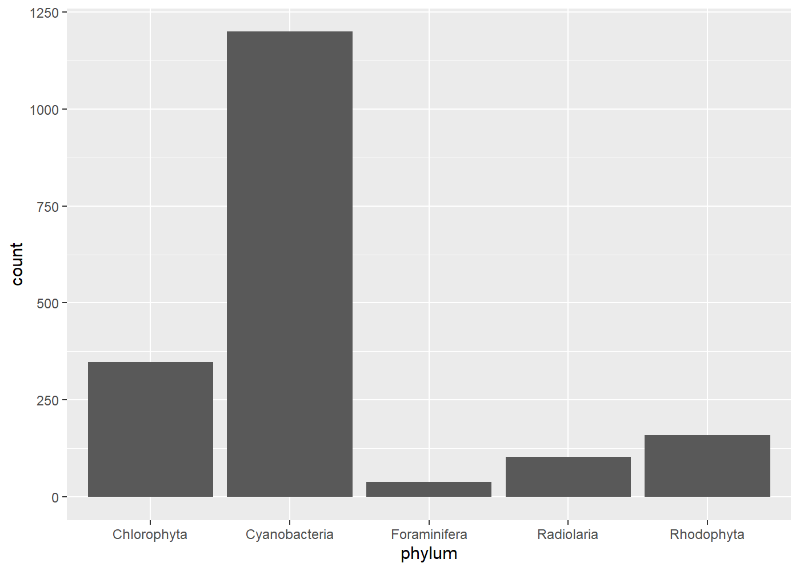
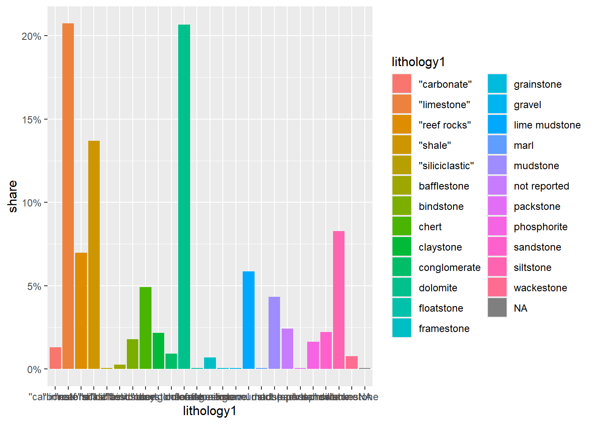
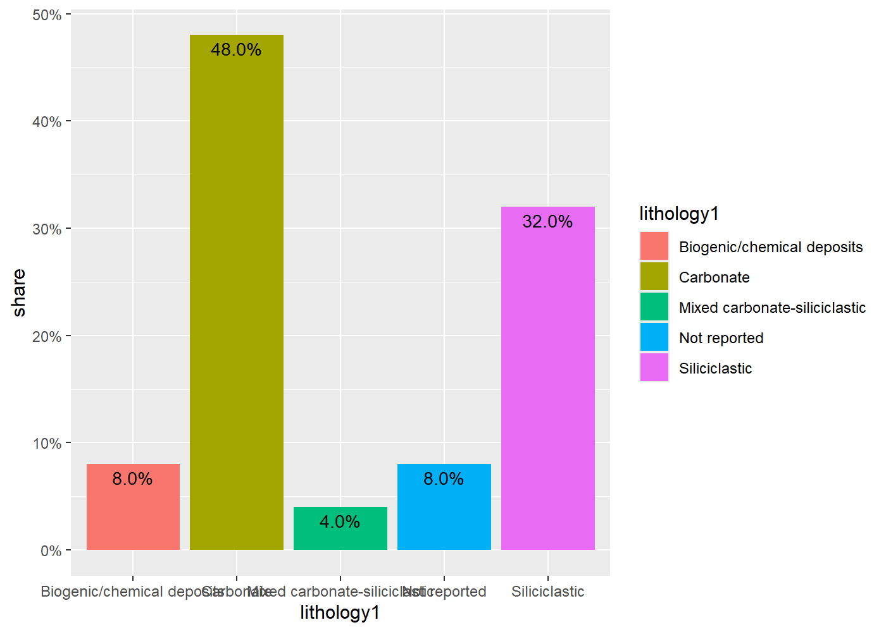

# EDA
Sofia Dominesey

## Background

I thought critically again and realized why not apply this project to my
capstone and have something extra to put in my capstone deliverables?

Some background on my capstone: I’m making maps of Mars! Specifically,
I’m looking for sites where microfossils could be preserved in surface
rocks. I’m doing this by looking at: - what the rocks are made of -
geologic units - current surface conditions - what these can tell us
about conditions on Noachian/Hesperian Mars - where and whether ancient
life from these periods could be preserved in those rocks

For this project, I want to make visualizations that help my audience
understand how what I’m looking at on Mars directly relates to what
we’ve studied and know about the Earth.

## Goal

Now that I’m applying this to my research, my goal is to show readers
which rock types on Earth have been shown to preserve ancient
microfossils, and whether that changes over time. If the same few rock
types keep showing up, that supports prioritizing them in my capstone
research.

Questions I want to answer: 1. Which lithologies (rock types) show early
fossil occurrences? 2. Does that mix change across time? 3. Does
lithology relate to depositional environment?

## Data

I’m using occurrence data from the Paleobiology Database (PBDB). In its
own words, “The Paleobiology Database is an online, non-governmental,
non-profit public resource for paleontological data.” Each row is one
fossil occurrence. - Downloaded: October 20, 2026, via the PBDB download
generator : https://paleobiodb.org/classic/displayDownloadGenerator -
Time interval: Archean through Cambrian - Records: 54,984 occurrences -
Parameters: \[1\] “occurrence_no” “record_type” “reid_no” “flags”
“collection_no” “identified_name” \[7\] “identified_rank”
“identified_no” “difference” “accepted_name” “accepted_rank”
“accepted_no”\
\[13\] “early_interval” “late_interval” “max_ma” “min_ma” “reference_no”
“phylum”\
\[19\] “class” “order” “family” “genus” “abund_value” “abund_unit”\
\[25\] “cc” “state” “county” “latlng_basis” “latlng_precision”
“altitude_value”\
\[31\] “altitude_unit” “geogscale” “geogcomments” “formation”
“geological_group” “member”\
\[37\] “lithdescript” “lithology1” “lithification1” “minor_lithology1”
“lithology2” “lithification2”\
\[43\] “minor_lithology2” “environment” “tectonic_setting”
“geology_comments” I think this is how to cite it -\> basically
everything I put in the csv generator to return the original data I used

## Plan and caveats

Most of these records are Cambrian animals, so my first step is
filtering to microbial and algal groups. After that I’ll clean up the
lithology labels and group them into categories that match my Mars
target rock types: chert/silica, fine-grained mudstone/shale, carbonate,
and other. The PBDB isn’t a complete record of microfossils, and the
counts reflect where people have looked as much as where life was
preserved.

``` r
library(tidyr)
```

    Warning: package 'tidyr' was built under R version 4.5.3

``` r
library(ggplot2)
```

    Warning: package 'ggplot2' was built under R version 4.5.3

``` r
library(dplyr)
```

    Warning: package 'dplyr' was built under R version 4.5.3

    Attaching package: 'dplyr'

    The following objects are masked from 'package:stats':

        filter, lag

    The following objects are masked from 'package:base':

        intersect, setdiff, setequal, union

``` r
df <- readr::read_csv(here::here("data", "pbdb_data.csv"))
```

    Rows: 54984 Columns: 46
    ── Column specification ────────────────────────────────────────────────────────
    Delimiter: ","
    chr (37): record_type, flags, identified_name, identified_rank, difference, ...
    dbl  (9): occurrence_no, reid_no, collection_no, identified_no, accepted_no,...

    ℹ Use `spec()` to retrieve the full column specification for this data.
    ℹ Specify the column types or set `show_col_types = FALSE` to quiet this message.

``` r
names(df)
```

     [1] "occurrence_no"    "record_type"      "reid_no"          "flags"           
     [5] "collection_no"    "identified_name"  "identified_rank"  "identified_no"   
     [9] "difference"       "accepted_name"    "accepted_rank"    "accepted_no"     
    [13] "early_interval"   "late_interval"    "max_ma"           "min_ma"          
    [17] "reference_no"     "phylum"           "class"            "order"           
    [21] "family"           "genus"            "abund_value"      "abund_unit"      
    [25] "cc"               "state"            "county"           "latlng_basis"    
    [29] "latlng_precision" "altitude_value"   "altitude_unit"    "geogscale"       
    [33] "geogcomments"     "formation"        "geological_group" "member"          
    [37] "lithdescript"     "lithology1"       "lithification1"   "minor_lithology1"
    [41] "lithology2"       "lithification2"   "minor_lithology2" "environment"     
    [45] "tectonic_setting" "geology_comments"

``` r
summary(df)
```

     occurrence_no     record_type           reid_no         flags          
     Min.   :   1182   Length:54984       Min.   :11122   Length:54984      
     1st Qu.: 745098   Class :character   1st Qu.:29957   Class :character  
     Median : 986912   Mode  :character   Median :40465   Mode  :character  
     Mean   :1009509                      Mean   :34536                     
     3rd Qu.:1426373                      3rd Qu.:42085                     
     Max.   :2078074                      Max.   :43525                     
                                          NA's   :54669                     
     collection_no    identified_name    identified_rank    identified_no   
     Min.   :   177   Length:54984       Length:54984       Min.   :     0  
     1st Qu.: 68910   Class :character   Class :character   1st Qu.: 76987  
     Median :108312   Mode  :character   Mode  :character   Median :201240  
     Mean   :122025                                         Mean   :219777  
     3rd Qu.:193783                                         3rd Qu.:393492  
     Max.   :281031                                         Max.   :526201  
                                                            NA's   :41264   
      difference        accepted_name      accepted_rank       accepted_no    
     Length:54984       Length:54984       Length:54984       Min.   :     4  
     Class :character   Class :character   Class :character   1st Qu.: 20592  
     Mode  :character   Mode  :character   Mode  :character   Median :151071  
                                                              Mean   :182751  
                                                              3rd Qu.:295093  
                                                              Max.   :526264  
                                                              NA's   :1881    
     early_interval     late_interval          max_ma           min_ma      
     Length:54984       Length:54984       Min.   : 488.3   Min.   : 477.1  
     Class :character   Class :character   1st Qu.: 499.5   1st Qu.: 497.0  
     Mode  :character   Mode  :character   Median : 509.7   Median : 505.3  
                                           Mean   : 541.6   Mean   : 523.1  
                                           3rd Qu.: 521.0   3rd Qu.: 516.0  
                                           Max.   :4031.0   Max.   :3600.0  
                                                                            
      reference_no      phylum             class              order          
     Min.   :  178   Length:54984       Length:54984       Length:54984      
     1st Qu.:19350   Class :character   Class :character   Class :character  
     Median :37504   Mode  :character   Mode  :character   Mode  :character  
     Mean   :41280                                                           
     3rd Qu.:62913                                                           
     Max.   :96228                                                           
                                                                             
        family             genus           abund_value         abund_unit       
     Length:54984       Length:54984       Length:54984       Length:54984      
     Class :character   Class :character   Class :character   Class :character  
     Mode  :character   Mode  :character   Mode  :character   Mode  :character  
                                                                                
                                                                                
                                                                                
                                                                                
          cc               state              county          latlng_basis      
     Length:54984       Length:54984       Length:54984       Length:54984      
     Class :character   Class :character   Class :character   Class :character  
     Mode  :character   Mode  :character   Mode  :character   Mode  :character  
                                                                                
                                                                                
                                                                                
                                                                                
     latlng_precision   altitude_value  altitude_unit       geogscale        
     Length:54984       Min.   :  90    Length:54984       Length:54984      
     Class :character   1st Qu.:1718    Class :character   Class :character  
     Mode  :character   Median :3942    Mode  :character   Mode  :character  
                        Mean   :3525                                         
                        3rd Qu.:4510                                         
                        Max.   :8000                                         
                        NA's   :54601                                        
     geogcomments        formation         geological_group      member         
     Length:54984       Length:54984       Length:54984       Length:54984      
     Class :character   Class :character   Class :character   Class :character  
     Mode  :character   Mode  :character   Mode  :character   Mode  :character  
                                                                                
                                                                                
                                                                                
                                                                                
     lithdescript        lithology1        lithification1     minor_lithology1  
     Length:54984       Length:54984       Length:54984       Length:54984      
     Class :character   Class :character   Class :character   Class :character  
     Mode  :character   Mode  :character   Mode  :character   Mode  :character  
                                                                                
                                                                                
                                                                                
                                                                                
      lithology2        lithification2     minor_lithology2   environment       
     Length:54984       Length:54984       Length:54984       Length:54984      
     Class :character   Class :character   Class :character   Class :character  
     Mode  :character   Mode  :character   Mode  :character   Mode  :character  
                                                                                
                                                                                
                                                                                
                                                                                
     tectonic_setting   geology_comments  
     Length:54984       Length:54984      
     Class :character   Class :character  
     Mode  :character   Mode  :character  
                                          
                                          
                                          
                                          

``` r
df <- df |>
  select(occurrence_no, 
         collection_no, 
         identified_name, 
         accepted_name, 
         phylum, 
         class, 
         genus, 
         early_interval, 
         max_ma, 
         min_ma, 
         formation, 
         lithology1, 
         lithology2, 
         lithdescript, 
         environment)
glimpse(df)
```

    Rows: 54,984
    Columns: 15
    $ occurrence_no   <dbl> 1182, 1183, 1224, 1225, 1226, 1227, 1228, 1229, 1230, …
    $ collection_no   <dbl> 177, 177, 181, 181, 181, 181, 181, 181, 181, 182, 182,…
    $ identified_name <chr> "Kutorgina perugata", "Yorkia ? wanneri", "Hyolithellu…
    $ accepted_name   <chr> "Kutorgina perugata", "Yorkia wanneri", "Hyolithellus"…
    $ phylum          <chr> "Brachiopoda", "Brachiopoda", "NO_PHYLUM_SPECIFIED", "…
    $ class           <chr> "Kutorginata", "Kutorginata", "NO_CLASS_SPECIFIED", "N…
    $ genus           <chr> "Kutorgina", "Yorkia", "Hyolithellus", "Hyolithes", "O…
    $ early_interval  <chr> "Dyeran", "Dyeran", "Caerfai", "Caerfai", "Caerfai", "…
    $ max_ma          <dbl> 515.3, 515.3, 538.8, 538.8, 538.8, 538.8, 538.8, 538.8…
    $ min_ma          <dbl> 509.7, 509.7, 506.5, 506.5, 506.5, 506.5, 506.5, 506.5…
    $ formation       <chr> "Poleta", "Poleta", NA, NA, NA, NA, NA, NA, NA, "Schod…
    $ lithology1      <chr> "\"shale\"", "\"shale\"", "\"shale\"", "\"shale\"", "\…
    $ lithology2      <chr> NA, NA, NA, NA, NA, NA, NA, NA, NA, "\"shale\"", "\"sh…
    $ lithdescript    <chr> NA, NA, NA, NA, NA, NA, NA, NA, NA, NA, NA, NA, NA, NA…
    $ environment     <chr> "offshore", "offshore", "marine indet.", "marine indet…

``` r
# i am not a biologist (i know, confusing) so i had do a little bit of researching here to pick out what the some of names here meant (most of the ones i didn't know were animals, go figure). i only want single celled organisms and simple algae, namely stuff like cyanobacteria. 
unique(df$phylum)
```

     [1] "Brachiopoda"         "NO_PHYLUM_SPECIFIED" "Hyolitha"           
     [4] "Arthropoda"          "Porifera"            NA                   
     [7] "Mollusca"            "Problematica"        "Cnidaria"           
    [10] "Echinodermata"       "Priapulida"          "Chordata"           
    [13] "Hemichordata"        "Cyanobacteria"       "Chlorophyta"        
    [16] "Lophotrochozoa"      "Onychophora"         "Annelida"           
    [19] "Foraminifera"        "Chaetognatha"        "Rhodophyta"         
    [22] "Bryozoa"             "Platyhelminthes"     "Proarticulata"      
    [25] "Petalonamae"         "Dinozoa"             "Ctenophora"         
    [28] "Uncertain"           "Entoprocta"          "Radiolaria"         
    [31] "Scalidophora"        "Tardigrada"          "Kinorhyncha"        
    [34] "Chytridiomycota"     "Pteridophyta"       

``` r
microbial_phylums <- df |>
  filter(phylum %in% 
           c("Cyanobacteria",        # photosynthetic bacteria
             "Chlorophyta",          # green algae
             "Foraminifera",         # single celled protists with shells
             "Rhodophyta",           # red algae
             "Dinozoa",              # more single celled algae basically
             "Radiolaria",           # single celled protists with silica skeletons (cool, right?)
             "Chytridiomycota"))    # single celled fungi
glimpse(microbial_phylums)
```

    Rows: 1,853
    Columns: 15
    $ occurrence_no   <dbl> 10708, 10711, 10713, 10717, 10718, 91898, 92719, 10109…
    $ collection_no   <dbl> 614, 614, 614, 614, 614, 6813, 6897, 7787, 7790, 7790,…
    $ identified_name <chr> "Siphonophycus typicum", "Ramivaginalis sp.", "Leiosph…
    $ accepted_name   <chr> "Siphonophycus typicum", "Ramivaginalis", "Leiosphaeri…
    $ phylum          <chr> "Cyanobacteria", "Cyanobacteria", "Chlorophyta", "Cyan…
    $ class           <chr> "Hormogoneae", "Cyanophyceae", "Chlorophyceae", "NO_CL…
    $ genus           <chr> "Siphonophycus", "Ramivaginalis", "Leiosphaeridia", "O…
    $ early_interval  <chr> "Tonian", "Tonian", "Tonian", "Tonian", "Tonian", "Edi…
    $ max_ma          <dbl> 1000.0, 1000.0, 1000.0, 1000.0, 1000.0, 635.0, 525.5, …
    $ min_ma          <dbl> 720.0, 720.0, 720.0, 720.0, 720.0, 538.8, 516.0, 509.7…
    $ formation       <chr> "Lone Land", "Lone Land", "Lone Land", "Lone Land", "L…
    $ lithology1      <chr> "\"shale\"", "\"shale\"", "\"shale\"", "\"shale\"", "\…
    $ lithology2      <chr> NA, NA, NA, NA, NA, "\"limestone\"", "\"shale\"", "\"s…
    $ lithdescript    <chr> NA, NA, NA, NA, NA, "formation is characterized by sil…
    $ environment     <chr> "marine indet.", "marine indet.", "marine indet.", "ma…

``` r
# now we're down to 1853 occurences <-- much easier to work with
```

``` r
phylum_dist <- ggplot(microbial_phylums, aes(x = phylum)) +
  geom_bar()
# most stuff is cyanobacteria, which is great. 

# cut out phylums with little to no occurences
microbial_phylums <- df |>
  filter(phylum %in% 
           c("Cyanobacteria",      
             "Chlorophyta",   
             "Foraminifera",   
             "Rhodophyta",             
             "Radiolaria"))  
phylum_dist <- ggplot(microbial_phylums, aes(x = phylum)) +
  geom_bar()
phylum_dist
```



``` r
# thinking about combining lithology1 and lithology2 columns in order to see bigger picture. 

# how many lithology2 columns are NA?
sum(is.na(microbial_phylums$lithology2))
```

    [1] 1597

``` r
# 1527 are NA ... so prob just best to look at primary lithology

lithology <- microbial_phylums |>
  count(lithology1) |>
  mutate(share = n / sum(n))

percent <- scales::label_percent(accuracy = 1)

lithology_dist <- ggplot(lithology, aes(x = lithology1, y = share, fill = lithology1)) +
  geom_col() +
  scale_y_continuous(labels = percent) 
lithology_dist
```



``` r
unique(lithology$lithology1)
```

     [1] "\"carbonate\""     "\"limestone\""     "\"reef rocks\""   
     [4] "\"shale\""         "\"siliciclastic\"" "bafflestone"      
     [7] "bindstone"         "chert"             "claystone"        
    [10] "conglomerate"      "dolomite"          "floatstone"       
    [13] "framestone"        "grainstone"        "gravel"           
    [16] "lime mudstone"     "marl"              "mudstone"         
    [19] "not reported"      "packstone"         "phosphorite"      
    [22] "sandstone"         "siltstone"         "wackestone"       
    [25] NA                 

``` r
# quotations mean general group name --> re-categorize the other ones to fall under these too
# get rid of NA
# https://www.biorxiv.org/content/10.64898/2026.10.15.759295v1
# supplementary materials shows how they categorized all the PBDB lithologies
# I'll use their categorization
lithology <- lithology |>
  mutate(lithology1 = case_when(
    lithology1 %in% c("\"limestone\"", "\"carbonate\"", "chalk", "dolomite", "lime mudstone",
                      "grainstone", "packstone", "wackestone", "rudstone", "floatstone",
                      "framestone", "bafflestone", "bindstone", "\"reef rocks\"") ~ "Carbonate",
    lithology1 %in% c("sandstone", "siltstone", "mudstone", "claystone",
                      "\"shale\"", "conglomerate", "gravel", "\"siliciclastic\"") ~ "Siliciclastic",
    lithology1 %in% c("marl") ~ "Mixed carbonate-siliciclastic",
    lithology1 %in% c("chert", "phosphorite") ~ "Biogenic/chemical deposits",
    lithology1 == "not reported" | is.na(lithology1) ~ "Not reported",
    .default = "other"
  )) |> 
  count(lithology1) |>
  mutate(share = n / sum(n))
 
lithology_dist <- ggplot(lithology, aes(x = lithology1, y = share, fill = lithology1)) +
  geom_col() +
  scale_y_continuous(labels = percent) +
  geom_text(
    aes(label = scales::percent(share, accuracy = 0.1)), 
    vjust = 1.5, 
    size = 3.5)
lithology_dist
```



``` r
# probably will end up using a similar graph for the final product
```

Carbonates show the most fossil occurrences (48%) for my selected time
periods, probably because microbes helped build carbonate rock (ex.
stromatolites), so the fossil and the rock formed together. Structures
like stromatolites can’t confirm life on their own, since abiotic
processes can produce similar forms, but they’re large enough to detect
with rover imaging. That makes carbonate a practical target on Mars, as
long as structures are paired with supporting evidence like mineralogy
and chemistry.

This is directly relevant to Jezero Crater, which is an ancient dried up
lake basin on the surface of Mars. CRISM (an imaging tool on the Mars
Reconnaissance Orbiter) show carbonate-bearing deposits in Jezero,
including along the crater’s inner margin, where they may have formed
near the shoreline of the ancient lake. On Earth, shallow, near-shore
water is exactly where microbial carbonates like stromatolites tend to
form. Perseverance has explored these units, so if Earth’s record is any
guide, Jezero’s carbonates are a strong place to look for microbial
structures, with the caveat that a structure alone won’t be enough to
confirm life.

## Environment

I think a cool plot for me to make would be an alluvial plot. More in
the sketches notebook …

``` r
unique(df$environment)
```

     [1] "offshore"                            
     [2] "marine indet."                       
     [3] "slope"                               
     [4] "shallow subtidal indet."             
     [5] "peritidal"                           
     [6] "reef, buildup or bioherm"            
     [7] "carbonate indet."                    
     [8] "offshore shelf"                      
     [9] "sand shoal"                          
    [10] "lagoonal"                            
    [11] "deep subtidal shelf"                 
    [12] "offshore ramp"                       
    [13] "transition zone/lower shoreface"     
    [14] NA                                    
    [15] "foreshore"                           
    [16] "submarine fan"                       
    [17] "delta front"                         
    [18] "shoreface"                           
    [19] "deep subtidal ramp"                  
    [20] "marginal marine indet."              
    [21] "coastal indet."                      
    [22] "basinal (carbonate)"                 
    [23] "deep-water indet."                   
    [24] "deep subtidal indet."                
    [25] "basinal (siliciclastic)"             
    [26] "offshore indet."                     
    [27] "prodelta"                            
    [28] "open shallow subtidal"               
    [29] "perireef or subreef"                 
    [30] "platform/shelf-margin reef"          
    [31] "deltaic indet."                      
    [32] "slope/ramp reef"                     
    [33] "intrashelf/intraplatform reef"       
    [34] "lagoonal/restricted shallow subtidal"
    [35] "basinal (siliceous)"                 
    [36] "terrestrial indet."                  
    [37] "glacial"                             
    [38] "paralic indet."                      
